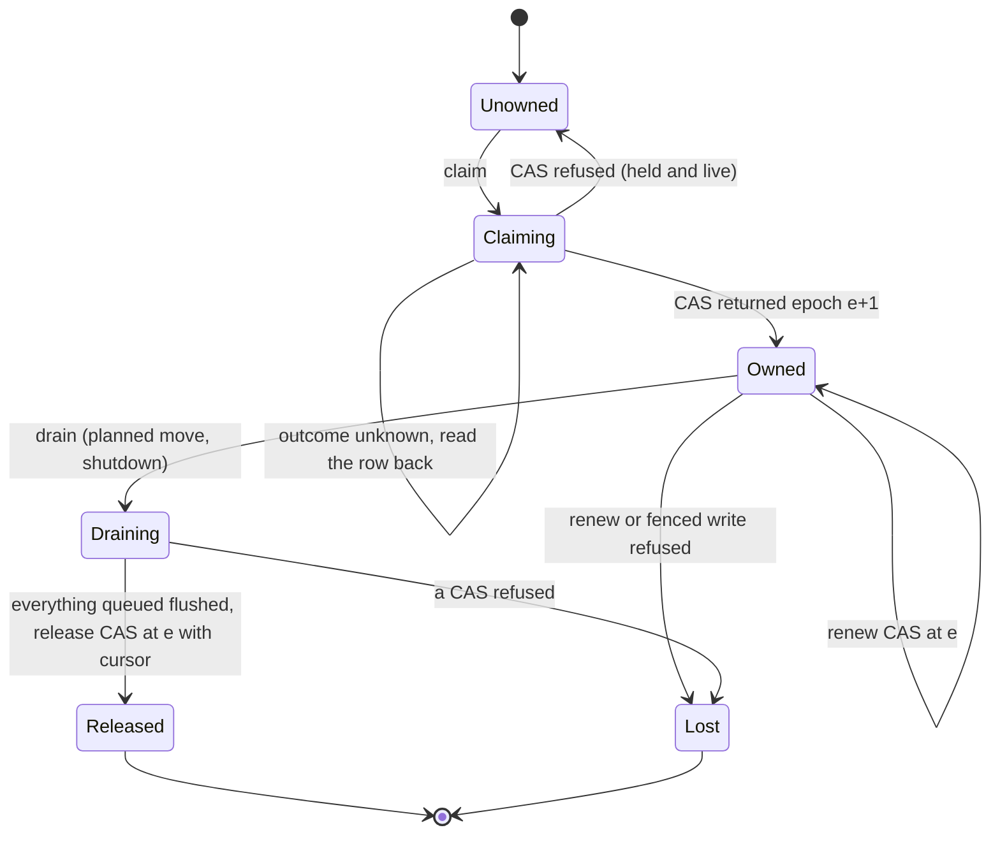

# Concurrency

Nanocode has to stay correct under heavy load by design, not because callers are careful. Every piece of shared state belongs to exactly one owner. Ownership is a lease with an epoch. Every durable write is a compare-and-set against that epoch or a revision. Nothing waits on a lock: a contended write either lands or is refused, and the refusal has a type.

This file holds the rules, the invariants the simulator checks, the ownership model, and the map of everything that still breaks a rule, with its replacement. An entry leaves the map when the commit that removes it lands.

Status (2026-11-25): nanocode-sync has no exclusive guard type left (`Sequencer`, `Owned`/`Held`/`Leased` and the lease watchdog are gone), `OnceCell` fills are single-flight, and `--tidy` refuses any guard held across an `.await`, with no allowance. What remains is in the map below, notably the Claude steering owner's jobs that span steer persistence, the one-transaction session log and durable store conversions, and the `mpp` payment locks. Every `Semaphore` acquire takes a deadline, and `--tidy` refuses `Semaphore::new(1)` anywhere.

## Rules

1. **One writer per scope per epoch.** A scope is a thread's log, a board, a log partition, a durable state or a workspace head. At most one owner holds a scope at a given epoch, and only that owner's writes at that epoch can land.
2. **No lost acknowledged writes.** An append that returned `Ok` is durable and stays visible to every later owner. A handoff carries the committed position forward. It never re-derives it.
3. **No lock across `.await` or the network.** In process there is no `Mutex`, `RwLock` or `Condvar`, no `Semaphore::new(1)` at all, and no other permit held across a suspension point to order access, and nanocode-sync offers no exclusive guard type; an async fill (`OnceCell::get_or_try_init`, `SingleFlight`) is single-flight, and a leader that fails or is dropped releases its waiters. In the database there are no advisory locks (session or transaction), no `FOR UPDATE`/`FOR SHARE`/`FOR KEY SHARE`, and no no-op `UPDATE` or upsert used as a mutex. The only row locks are the ones Postgres takes for the single compare-and-set statement itself, inside a pipelined transaction that never waits on the client.
4. **No DDL on open.** Schema changes run in a one-shot `migrate` step before anything serves. Opening a store reads the stored format version once per process and returns `SchemaBehind` if it's old. It never creates, alters or indexes anything.
5. **Liveness is lease expiry, judged on the database clock.** A dropped connection, proxy cut or failover is a transport event. It doesn't mean ownership is lost. Ownership is lost only when a fenced write or a renewal compare-and-set says the epoch moved. Membership heartbeats may rank who claims next. They never authorize taking a lease.
6. **Every wait has a deadline.** Pool checkout, connect, `lock_timeout`, `statement_timeout` and `idle_in_transaction_session_timeout` are set for every transaction class. When a deadline passes, the caller gets a typed refusal (`Busy`, `Lost`, `SchemaBehind`), never a hang. In store-sql, `PgLimits` (given to `PgPool::limited`) holds one deadline for pool acquire plus connect, and the three server timeouts for each `SqlAccess` class. Each batch sets its class's timeouts local to its transaction (`Autocommit` sets them for the session and resets it after), a lock or statement timeout answers `Busy`, and a batch the server doesn't answer within its statement timeout is cancelled on the server with a `CancelRequest` and its connection dropped. `PgSql::call_bound` reports the acquire deadline plus the statement timeout plus the acquire deadline again (the cancel) for the slowest transaction class, so a turn log over it bounds each call past the store's own typed answer; an `Autocommit` call runs each statement under its own bound and is outside it.
7. **Capacity is not ownership.** A `Semaphore` bounds resources (CPU, memory, connections), and its permit is acquired with a deadline: `acquire_within`, `acquire_many_within` and their `_owned` forms take a deadline future and answer `AcquireError::Busy` when it resolves first, and there is no acquire without one. It never serializes access to state: a capacity comes from what it bounds, and `--tidy` refuses a `Semaphore::new(1)`.
8. **State is owned and resident; a log is never opened per request.** A scope's folded state lives in its lease owner's memory for the whole lease. Apps reach a scope through `Scopes::get`, write commands to it and read its published state. Nothing outside the scope runtime opens, claims or replays a log. A cold claim loads a materialized checkpoint of the folded values plus a bounded tail, so its cost is O(state + N) and never O(history). `crates/runtime/scope` (`nanocode-scope`) is that runtime, and `--scenario scope` checks I8-I12; the callers that still open a log per request are the ones `bin/nanocode-sim/opens-outside-scopes.txt` counts.

## Invariants

Each invariant has a check in `bin/nanocode-sim` and a mutation that breaks it. The sweep must turn red for each mutation (`bin/nanocode-sim/cfo.sh` runs them as canaries). "To add" marks a check the simulator doesn't make yet. It lands with its mutation, in the commit that removes the map entries it covers.

| Invariant | Sim check | Mutation |
|---|---|---|
| **I1** Exactly one writer per scope per epoch | `--scenario partitions` invariant 1 (one holder per epoch, epochs never go back); `--scenario lease` I1 (an epoch is issued once, a commit lands only at the current epoch from its claimant, a node that believes it may write holds the row before its database expiry) | `claim_keeps_epoch`, `double_claim`; `lease`: `claim_keeps_epoch`, `write_skips_head_cas` |
| **I2** No lost acknowledged writes | `--scenario plog` (every acked row is read back by the next owner, and in its handoff phase every append queued before a release flushes at the held epoch); `--scenario partitions` invariant 3 (no replay, one result); `--scenario mpp` server spent (a channel's persisted server spent is a forward-only compare-and-set: saves landing out of order never move it back, and it ends at the highest save) and reservations (concurrent payers on one channel never reserve the same cumulative amount, and the stored amount ends at the sum of what they reserved); `--scenario append` (a turn log append whose answer is lost 1 to 5 times, each attempt landing at once, after the immediate read-back or never, with that read-back sometimes failing, lands exactly once at the seq its first attempt wrote and its commit answers that seq; a retry reads the unsettled attempt back before it sends anything, so no insert reaches a row it already landed and none reaches the store as a duplicate key; a second writer at a held seq is refused as Fenced and changes nothing) | `partial`, `overwrite`, `lost_ack_rejected`, `replays_in_flight`, `drain_refuses_queued`; `lease`: `release_drops_cursor` (a release records the committed position); `mpp`: `spent_save_regresses` (a lower save overwrites a higher one), `reserve_skips_compare` (a reservation lands without comparing the stored amount); `append`: `retry_skips_read_back` (a retry after an unknown outcome sends its rows again without reading the earlier attempt back), `conflict_skips_read_back` (an insert that skipped a held seq is taken as landed without reading the row back) |
| **I3** No lock held across `.await` or the network | `--scenario lease` I3 (a renewal never waits on a row a commit holds); `--tidy` refuses row-lock SQL in `parted/sql.rs` and `durability/src/sql.rs`, and refuses any `Semaphore::new(1)` permit (or a guard of a type named `Sequencer` or `Owned`) bound to a variable that lives across an `.await` in `crates/` or `bin/`, with no allowance, and any `Semaphore::new(1)` at all in `crates/`, `bin/` or `examples/`; `--scenario held_await` checks both detectors against generated owners; `--scenario sync` once cells (fillers that fail, give up or are dropped mid-init release their waiters, one init runs at a time, and a filled cell runs no init); `--scenario workspace_crash` race (two writers over one `WorkspaceFs` or two views of one store never wait on each other's commit: a write the head CAS refuses retries from the newer head, so every token is acknowledged); `--scenario cell_calls` admission (a Code Mode terminate returns while an exec's journal load is stalled, and that exec, once loaded, is refused by the epoch the terminate moved), and observer (with the cell's journal saves stalled, a wait that has passed its yield holds no observer claim, so the next wait on the cell is not refused as busy); `--scenario backend_facts` fact owner (a Claude or Codex fact commit whose caller goes away while its append is stalled, before or after the append lands, leaves the owner usable: the next commit follows the log's last fact and the owner's fold is at the log's head), Claude continuation loads (a load waits only for a prefetch of its own operation, and only while that prefetch runs), and the Claude session owner (an admission command that waits on a persistence command finishes, a persistence command read at a moved boundary revision is refused, and a write whose caller went away mid-flight still moves the revision), and the Claude conversation desk (with a turn's first model stream held open, a checkpoint read, a steer and an interrupt are each answered before the stream ends: the desk lends the conversation to the turn by value and keeps answering while it is out); `--scenario agents` residency claims (concurrent messages to an evicted subagent restore it once: a start, restore, eviction or hibernation is a claim in the owner's state that all-or-nothing admits only a free agent, pins are shared, and waiters watch for a release instead of queueing on a lock), and scope jobs (an interrupt of one subagent does not wait for the harness stop of a close of another: a close, interrupt or board steer stops aside and reports back by message, and only a job on an overlapping subtree, or a scope-wide one, waits for it; a released scope's job state is dropped); `--scenario slog` writer stops (a session log whose writer task stopped, idle or mid-call, serves the next call from a fresh writer that claims a new epoch; the call in flight fails rather than succeeds, and never as not committed; the events the stopped writer held, staged or in a write whose answer was lost before or after it landed, are reported by count as outcome unknown to the first caller to see the stop, whether that is the call in flight or a new call, which then did not run, including when the call in flight was dropped with its writer; `SessionLog::start_writer` over a stopped writer spawns a fresh one in the caller's task scope at once, or reports what the stopped writer held); to add: a stalled store or model call on one scope must not delay any other scope's step | `lease`: `commit_locks_lease`; `held_await`: `held_across_await` (an owner keeps its turn across a store call), `mutex_semaphore` (a constructor builds a `Semaphore::new(1)`); `sync`: `fill_keeps_abandoned` (a failed or dropped fill leaves its waiters waiting); `workspace_crash`: `stale_surfaces` (a refused write returns the refusal instead of retrying); `cell_calls`: `admission_held` (an exec keeps admission closed across its journal load), `admits_stale` (a cell is admitted at a moved epoch), `observer_save_held` (a wait keeps the observer claim across its journal save); `backend_facts`: `abandoned_commit_poisons` (an owner whose commit was abandoned refuses every later call), `demand_waits_any_prefetch` (a load waits for a prefetch of another operation), `persistence_on_admission_lane` (persistence commands queue behind admissions), `persist_ignores_revision` (a write lands at a moved revision), `abandoned_persist_keeps_revision` (an abandoned write leaves the revision where it was), `lend_blocks_owner` (the desk answers nothing else until a loan comes back), `steer_waits_conversation` (a steer borrows the conversation before it steers); `agents`: `restore_shares_claim` (a restore takes a shared pin instead of a move claim), `scope_jobs_stop_inline` (the job task awaits each stop itself), `scope_locks_kept` (released scopes keep their job state); `slog`: `writer_never_respawned` (a session log keeps its stopped writer task, so every later call fails), `staged_dropped` (lines staged on a stopped writer vanish unreported), `held_after_job` (the writer publishes what it holds only after a job, so a write in flight is missing from the report), `held_unwritten` (a new call reports the held events as unwritten), `start_writer_keeps_stopped` (`start_writer` leaves a stopped writer in place and spawns nothing) |
| **I4** A claim never takes a live lease | `--scenario lease` I4: no claim lands on a row that is held by another node, not `Released`, and has `expires_at + grace >= now` on the database clock; `--scenario durable` I4, the same for a leased `SqlStore` claim; `--scenario kv_lease` I4, the same for a leased `KeyValueStore` claim on its backend's clock, and a `Busy` refusal only over a live lease | `lease`: `claim_steals_live`, `claim_skips_grace`; `durable`: `claim_steals_live`, `claim_skips_grace`; `kv_lease`: `claim_steals_live`, `claim_skips_grace` |
| **I5** A `Lost` epoch never writes again | `--scenario partitions` invariant 2 (fenced appends); `--scenario plog` fence check; `--scenario lease` I5 (a renewal lands only at the row's epoch and holder); `--scenario durable` I5 (a `SqlStore` commit lands only from the owner and fence the last claim named); `--scenario slog` (a session log writer whose epoch moved never appends, and a batch refused as `Lost` lands nothing) | `unfenced` (both scenarios); `durable`: `write_skips_fence`; `lease`: `renew_ignores_epoch`; `slog`: `append_skips_epoch` |
| **I6** Every wait has a deadline and a typed refusal | `--scenario plog` gains phase (a gain that finds no recovery capacity answers `Busy` at its deadline); `--scenario sync` semaphore (an acquire whose deadline passes answers `Busy`, is never granted after its deadline, and leaves no waiter queued and no permit held); `--tidy` refuses an `acquire`, `acquire_owned`, `acquire_many`, `connect` or `connect_reusing` call awaited directly, not raced against a deadline, in store-sql and the partitioned log, beyond the per-file counts in `bin/nanocode-sim/waits-unbounded.txt`, which must match exactly so they only shrink; `--scenario held_await` checks that detector against generated pools; `--scenario pg_pool` (with a store that never answers or connections that are never returned, every caller of store-sql's pool returns `Busy` within its acquire deadline, a connection is lent only when the store made one, and never more than the pool holds; and every bound call, through pool acquire, its batch and the server cancel of a batch nobody answered, returns within the `call_bound` its limits report, `Busy` for a read and outcome unknown for a write); `--scenario durable` purge (a records `purge_within` answers within its budget: each batch is its own transaction under a statement deadline of the budget left, deletes at most its batch, and a purge that reports finished leaves no record past its grace); `--scenario executor` refusals (a blocking task whose thread spawn fails while the pool has no thread left resolves at once as refused, naming the spawn's error, and one queued behind a live thread while spawns fail still runs) | `plog`: `gain_waits_unbounded`; `sync`: `acquire_ignores_deadline` (an acquire waits past its deadline); `held_await`: `waits_unbounded` (a pool acquire without a deadline); `pg_pool`: `waits_unbounded` (pool acquire or connect without a deadline), `call_bound_skips_cancel` (the reported call bound leaves out the cancel's wait); `durable`: `purge_unbatched` (a batch deletes past its limit), `purge_skips_deadline` (a batch runs without the budget's statement deadline), `purge_finishes_early` (a full batch reports the purge finished); `executor`: `strands_refused` (a task whose thread spawn failed stays queued with no thread to run it), `refuses_served` (a task queued behind a live thread is refused) |
| **I7** GC never deletes a record a committed state references, and never fences an owner | `--scenario durable`: after every commit, each state's committed head references only records that exist and that it holds; a collect or a row store compaction never moves a fence; `--scenario workspace_sql`: after every commit and collect, each committed workspace manifest has one `(workspace, digest)` reference row per blob it names and no other, and each of those blobs exists with its bytes | `durable`: `purge_skips_grace`, `commit_skips_revive`, `collect_fences_owner`; `workspace_sql`: `sweep_ignores_refs` |

The simulator models the lease row, owners, the network and the database clock. It drives every transition, injects a crash after every step (before and after each CAS lands, between flush and release), and plays stale-epoch writes after every handoff. Under real load, the measurement is: no lock waits (sampled `wait_event_type = 'Lock'` and `pg_locks WHERE NOT granted`), no statement timeouts, throughput that grows with the number of owners, and handoff stall time.

## Resident scopes

Rule 1 gives every scope one writer. It doesn't keep that writer's state. When a host opens a log per request, it pays for the scope's whole history again on each one: load the snapshot, replay the tail, commit a claim, read sections that still live in old rows, then drop the handle. Leases don't prevent this. They decide who may write, not what stays in memory. So the scope runtime owns both: the lease, and the folded state for as long as the lease lasts.

### API

```text
Scopes<F: Resident>          one per process (crates/runtime/scope): leases, residents, checkpoints and routing over the host's LogHost
  Scopes::new(Wiring { fold, log, leases, checkpoints, route, policy, clock, claimed })
  scopes.get(scope)     -> Reached::Local(Scope<F>) | Reached::Routed(Routed<F>)   the owner here, the holder elsewhere, or a claim
  scopes.serve(scope, command)   the receiving end of a Route: only the holder serves, anyone else answers Moved
  scopes.release(part), drain(scope), renew(), tick(), stats()
Scope<F>                     a strong, cloneable handle; never weak, never per turn
  scope.send(command)   -> Committed<F::Reply>    one queue per scope; group commit; epoch-fenced
  scope.state()         -> Arc<F::State>          last committed state, from an Atom; never queues
  scope.watch()         -> watch::Receiver<Arc<F::State>>   committed folds, for followers
Routed<F>
  routed.send(command)  -> Committed<F::Reply>    forwarded to the lease row's holder within Policy::forward_ms
trait Resident           the app's fold: State, Command, Reply, empty, decide(&State, &Command) -> (rows, Reply),
                         apply(&mut State, seq, row), encode/decode of State as named Parts, weight
```

- **Owner.** Owning a partition's lease (`PartedLeases` over the `PartedLog` lease row, `nanocode_log_fence` on SQL) owns every resident scope that hashes to that partition; there is no second lease. Each resident has one queue. The sender that finds it idle leads: it takes the state by value, decides and folds every queued command onto one copy, appends all their rows in one `LogHost::append`, and only after that lands publishes `Arc<F::State>` to an `Atom` and the watch. A leader dropped while its append is in flight marks the scope Lost (the outcome is unknown) and answers the commands still queued Moved; those were never written, so `send` resolves the scope again and retries them once.
- **Reads.** `state()` and `watch()` read the published `Arc`, so a reader never waits behind an append (snapshot isolation at the last commit). Only `send` serializes, and only within its own scope.
- **Routing.** `get` reads the partition's lease row. Held here: the local owner. Held by another node: a `Routed` handle that forwards through the host's `Route` (HTTP in `examples/scoped-api`) and answers `Unreachable` once `Policy::forward_ms` passes, since the command may have reached the holder. Released, or held by a node a forward just missed: a claim, which the store refuses while the lease is live. `stats()` reports forwards, their total and longest latency, and the Busy and Unreachable answers.
- **No per-request open.** `--tidy` refuses a call to `TurnLog::open`, `TurnLog::follow`, `OneLog::open`, `OneLog::claim` or a `PartedLog` partition `claim` or `gain` in `crates/`, `bin/` and `examples/` outside the scope runtime (and the thread scope's adoption, which `Scopes::get` runs on a first claim), the partitioned log itself and the simulator, beyond the per-file counts in `bin/nanocode-sim/opens-outside-scopes.txt`, which must match exactly so they only shrink. `TurnLog::open`, `TurnLog::follow`, `OneLog::open`, `OneLog::claim`, `nanocode::turnlog` and `nanocode::turnlog_claim` stay public because hosts outside this repository open their logs through them; a listed caller leaves the file when it moves to `Scopes::get`.
- **Residency ends only by handoff.** A resident leaves memory only through `Draining` → final checkpoint → `Released { seq }`: on `release(part)` (a planned move or shutdown), on `drain(scope)`, or when resident bytes (`Resident::weight`) pass `Policy::resident_bytes_max`, which drains the least recently used idle scope. A drain whose checkpoint fails keeps the scope resident. A lost lease drops its residents without a checkpoint: their rows are the new owner's to fold.

### Checkpoints hold values

- A checkpoint is `Resident::encode(&State)`: named parts holding the folded values themselves, not keys into older rows. Each part is stored once by its blake3 digest in `nanocode_checkpoint_part (digest, body)`, and a checkpoint is one manifest row `nanocode_checkpoint_manifest (scope, seq, epoch, parts)` whose `parts` is a listing (`Listing`): either whole, every part's name and digest (a JSON array), or changed, the names put or dropped since the manifest at `base` (a JSON object). A changed listing lands only while the scope's newest manifest is its `base`. `SqlCheckpoints::migrate` creates both tables (component `scope_checkpoint`), and serving code opens with the `Migrated` it returns. The turn log's own `nanocode_checkpoint` is a different table.
- A checkpoint writes only the parts whose digest its scope's last checkpoint doesn't name, so an unchanged part costs no WAL, and a changed listing names only what changed, so a turn rewrites a few small rows. The owner writes a whole listing instead once the changed listings since the last whole one would pass the whole listing's own size, so a cold claim reads at most twice a whole listing's bytes of manifests (`assemble` folds the chain from the newest whole listing and checks that each changed one follows the one before).
- The owner writes one before a commit would leave more than `Policy::checkpoint_rows` rows after the last one, after a commit once `Policy::checkpoint_ms` has passed, on `tick()`, and always on drain. Every statement of the write is fenced in SQL: it lands only while `nanocode_log_fence` names the writer at its epoch, and the manifest only above every earlier manifest's seq and epoch. A refused manifest answers `Stale` and the owner stops as Lost.
- A cold claim reads the newest manifest, its parts, and the rows from its seq on, at most `checkpoint_rows` of them. Rows before it are never read on open, and none are pruned; a history reader takes its own path, never `get`.
- After a planned handoff the checkpoint is at the head, so the gainer replays zero rows. A deploy costs one checkpoint load per scope that is touched, not a scan.

### Invariants

`nanocode-sim --scenario scope` runs two or three nodes over one model store with leases on its clock, in virtual time: it crashes and restarts nodes, pauses them until their leases lapse and are claimed, releases partitions, stalls and abandons appends, and forwards to holders that never answer. Every seed also runs five scripted races: the old owner is paused with rows past its checkpoint, a forward to it goes unanswered, its lease lapses and is claimed, and it then writes a checkpoint at its old epoch before the new owner's first checkpoint, after it, in a release, after the new owner crashes and its lease lapses too, or before its next append.

| Invariant | Check | Mutation |
|---|---|---|
| I8 a cold claim reads at most one checkpoint and N tail rows | every scan a claim makes starts at the newest manifest's seq and returns at most `checkpoint_rows` rows | `checkpoint_indexes_only`: the claim ignores the checkpoint and scans history |
| I9 a read never waits on an append | with an append stalled, `state()` from another thread answers within 1 s | `read_through_writer`: reads queue behind the writer |
| I10 the state a reader sees is a committed fold | during the stall, and for every handle after every step, `state()` equals a refold of the committed rows below its seq | `publish_before_commit` |
| I11 a stale owner's checkpoint never lands | after a lapsed lease is claimed, the old owner ticks, drains, releases and appends at its old epoch; a landed manifest matches the lease row's holder and epoch | `checkpoint_skips_epoch`: the store skips the fence |
| I12 a resident is dropped only after a final checkpoint at its release cursor | a scope that left a node still holding its lease (an eviction, drain or release) has its newest manifest at the log's head | `evict_without_checkpoint` |
| A checkpoint writes only the parts that changed | a landed checkpoint sends no part its scope's previous manifest names | `checkpoint_rewrites_unchanged_parts` |
| A manifest's listing assembles to the parts its state encodes, and its chain stays under a whole listing | the landed manifest's assembled parts equal the encoded ones (`--scenario thread_scope`, whose cells, calls and wakes drop parts), and its changed bytes since the last whole listing are at most the whole listing's size (`--scenario scope`) | `listing_skips_dropped` (thread_scope), `listing_chain_unbounded` (scope) |
| A forward has a deadline | a forward to a holder that never answers returns before a 1 s watchdog | `forward_waits_unbounded` |
| A command is decided once per admission | a burst of 3-6 sends to one owner, with its first append held so the rest queue into one batch past `checkpoint_rows`, commits at one epoch only commands its owner decided once: a command that does not fit the batch keeps the rows it decided for the next one, and is decided again only after a refusal or an epoch move sends it to another owner | `deferred_redecided`: the owner decides a deferred command again |
| A staged write is never visible before it commits | after each `Scope::stage` (1-3 per action), the handle's `state()` equals a refold of the committed rows below its seq | `staged_published`: staging publishes the owner's working state |
| A write acknowledged as durable is never lost | a `flush` that answers at row n finds the log's head at or past n | `flush_skips_staged`: a flush answers without committing the staged rows |
| A rider commits atomically with its rows | a `flush` with a `Carry` that answers `carried` finds its statements in the one `LogHost::carry` write that ends at its row, and no carry write lands without rows | `rider_split`: the owner appends the rows, then carries the rider in a write of its own |

### The thread log as a resident scope

`ThreadLogs` (in `nanocode-agent`, re-exported as `nanocode::turnlog::ThreadLogs`) is a thread's turn log as a `Resident`. Its rows are turn log records, its state (`ThreadState`) holds turns, events, facts, cells, checkpoints, stored values, host fields, holds, open calls, model responses and wakes in persistent maps, and a checkpoint splits it into one part per cell, hold, host field and wake, with turns (in admission order), events, facts and model responses in chunks of `ThreadPolicy::part_rows`, so a turn rewrites a few parts and finished turns land in sealed chunks that are written once. On Postgres 18 a thread of 4-commit turns appends about 2,860 WAL bytes per turn; with `part_rows` 128 and `checkpoint_rows` 1,024 (a checkpoint about every 256 such turns, and `checkpoint_ms` long enough that time doesn't checkpoint a busy thread sooner) its checkpoints add 3.7-9.6% to that, and a cold claim replays at most those 1,024 rows. A host wires it like any scope and calls the turn operations on the handle:

```text
let threads = ThreadLogs::new(Wiring { fold: Arc::new(ThreadFold::new(ThreadPolicy { .. })), log, leases, checkpoints, route, policy, clock, claimed });
let thread = threads.get(thread_id).await?;          // local owner, or a route to the holder
thread.submit(&submission).await?; thread.start(id).await?; thread.append(&entries).await?; thread.finish(id, state, &fields).await?;
thread.turn(id).await?; thread.pending().await?;     // reads of the published state when local, commands when routed
thread.state()                                       // Arc<ThreadState>: cells, holds, facts, wakes, ...
```

`log` is any `Arc<dyn LogHost>`, so a tiered host log works. The fold refuses rows that point at older rows (index, section, segment, folded and retired records) and blob references, since it holds values, so a thread the turn log's own writer wrote (`TurnLog`, `OneLog`: snapshots, owner sections, segments, retired turns, blob values) is adopted on its first claim instead: when the checkpoint store holds no manifest for a scope, `Scopes::get` calls `Resident::adopt(log, scope)` (default `None`) before it reads the tail, and when that returns `Adopted { state, next, rows, bytes }` the owner writes its first checkpoint at `next` before it serves, fenced like every checkpoint, so every later claim reads that manifest and its tail and never the old rows. `ThreadFold::adopt` reads the scope's latest rows once; when they all fold as plain rows there is nothing to adopt. Otherwise it opens the old log with `TurnLog::open` over a host that counts what it reads and refuses every write, loads every index page and owner section (`TurnLog::load_all`), reads every event through `history`, every fact through `facts_from` with blob values resolved through `blobs`, and takes the old fold's turns, cells, checkpoints, stored values, host fields, holds, open calls, model responses and wakes as values. A retired turn becomes a finished turn with its first and last event, outcome, hand and the result event at its last seq, and digest `retired:<tag>`, which a resubmission of the same prompt still matches. `Stats` counts `adoptions` and the `adoption_rows` and `adoption_bytes` they read. `claimed` is a hook the runtime calls on every claim before it reads the manifest. A command reaches the owner in one of two classes. `send` (and `ThreadLog::job`) is durable: it is answered once its rows commit. `stage` (`ThreadLog::job_staged`) is staged, not yet durable: the owner decides it against its working state (the committed state plus every staged row, so later decisions number past them), answers it at once, and keeps its rows for the next group commit; reads see them only after that commit. `flush(carry)` is a durable settle: it forces the staged rows into a commit and answers `Flushed { next, carried }`; with a `Carry` (a host's SQL statements) the rows and the statements commit in one `LogHost::carry` write, and a host that can't carry commits the rows alone and answers `carried: false`. A drain or eviction flushes first and keeps the scope serving when that fails. An owner that loses its lease with rows staged drops them, and its next flush answers `Lost` (`Uncertain` while an append of them may still land), so only a flush acknowledges durability. The owner decides each command once per admission: one that does not fit a batch keeps the rows it decided for the next one, so `ThreadLog::job_once` can run a `FnOnce` (`ThreadFacts` appends through it) (a fact log `Append` moves the fold it commits); if its batch is refused and it reaches another owner, it answers `NotCommitted` and writes nothing. `OneLog` still opens its own writer and is counted in `opens-outside-scopes.txt`.

`nanocode-sim --scenario thread_scope` runs random turn, event, cell, fact, hold, wake and stored-value commands from two or three nodes with releases, crashes and evictions. After every step each handle's state equals a refold of the committed rows below its seq, a cold claim from the newest checkpoint plus its tail equals a refold of every row, and at the end the turn log's own `Fold` over the same rows agrees on turns, phases, events, cells, holds, facts, open calls, unknown calls, intents with the fact state that opened them (scoped fact logs' intents included), each turn's next recovery attempt and whether the last row recovered a turn. About half the threads start with a history the old writer wrote (`TurnLog` with 2-5 snapshot rows, 0-2 retained finished turns, 700-3,000 byte rows and some 16 KiB prompts stored as blobs). On the first local claim of one, its first manifest must be at the old log's head, and its decoded state must equal the old writer's own view of turns (retired ones by their summary and result event), events, facts with blobs resolved, cells, holds, open calls, checkpoints, stored values, host fields and wakes; later refolds start from that checkpoint, and no history is adopted twice. Some steps run a job instead (`ThreadLog::job`: a synchronous closure over a staged copy of the thread's state, whose staged rows commit in the owner's group commit and publish only after it): a job through a node that routes the thread must answer `ScopeError::Routed` and write nothing, and a job that ran must find the event and fact seqs it answered in the committed rows. A thread keeps resident only what its reads and decisions need: live turns and the turns that finished in its last `recent_rows` rows (at least `checkpoint_rows`), open intents, holds and wakes, the sessions that log facts, and the events and facts of those rows; older events, facts and finished turns stay in the log, behind seq ranges and a fixed-size filter of the moved turns' request ids (`ThreadPolicy::finished_filter`), and `thread_history` pages them from there, never at a claim. A lookup of a request id the filter may hold (an admission, a turn read, a cancel, a retry, a wake firing) reads that turn back from the rows below the filter's horizon (`thread_history::probe`) and decides again with it. Every cold claim's checkpoint must hold exactly the events and facts of the rows in that window and no turn that finished before it, and its tail must be at most `checkpoint_rows` rows, whatever the history's length. Some steps resubmit an earlier request id: one the committed rows admit must never be accepted again. Some steps stage an event (`ThreadLog::job_staged`) and crash the node before its group commit: a staged job hands out event seqs only inside a reservation the thread committed at the owner's epoch (`ThreadPolicy::events_ahead`), and otherwise runs again as a committed job that commits the next reservation, so a new owner continues past every seq a crashed owner may have answered, and no seq answered to a writer is ever committed with another event. Mutations `part_dropped` (encode loses a part), `adoption_skips_retired`, `adoption_skips_blobs` (facts keep blob references), `adoption_skips_checkpoint` (the owner serves an adopted thread before its first checkpoint), `job_forwarded` (a job is forwarded to the holder) and `job_rows_dropped` (a job's last staged row is not committed), `scoped_intent_skipped` (facts with a state open no intents) `facts_unseen_skipped` (a fact log append through a thread skips the facts its fold has not seen), `keep_all_events` (a thread keeps every event and fact resident), `keep_finished_turns` (a thread keeps every finished turn resident), `admission_skips_history` (a lookup misses a turn that moved into history) and `reservation_skipped` (a staged job hands out seqs past its committed reservation) turn it red. Some steps commit through `ThreadFacts`, the `FactLogs` a backend fact owner opens over a thread: two folds replayed at one fact, the first commits a decision, the second (now behind) commits an input, some past `VALUE_INLINE_BYTES` so they go through blob markers and cached folds; the second fold must equal a fresh replay of the thread. Each seed then drives `ThreadTurns` (the turn lifecycle of `OneLog` as jobs on a resident thread: admissions, appends, starts with recovery attempts, finishes, cancels, steered withdrawals, interrupts, retries and intent settlement) and a `OneLog` over its own log with the same random operations and reopens, and every answer and every turn must match apart from sequence numbers; a recovering start must count its attempt in the thread's state and fail a turn past its restarts. A recovery marker's attempts count across snapshot rows on both: a snapshot row is not progress. Mutations `recovery_uncounted` (a recovering start writes no recovery) and `snapshot_resets_recovery` (the turn log takes a snapshot row as progress and resets a marker's attempts there) turn it red. Each seed also drives `ThreadHolds` (the hold ledger, effect gate and remote barrier of `OneLog` over a resident thread: hold, resolve, release and abandon are durable jobs, a tool result is staged, and an owed settle or carry is `flush`, with a `Carry` for a carry) and a `OneLog` over its own log with the same random holds, resolutions, running reads, claims, releases, gated calls, tool results, abandons, intents and carries, and reopens: every answer must match, the thread's committed holds must equal the turn log's after every step, and an owed settle must leave nothing staged. Both gates refuse a call to a tool its intent did not name, and some gated calls run under a child id (`<call>/start`, as Claude's Monitor starts its Bash) whose parent's intent names another tool: both gates must answer them alike. Mutations `hold_staged` (a hold transition is staged, not committed) and `gate_compares_intent_to_itself` (`OneLog`'s gate compares an intent's tool with itself and lets such a call through) turn it red. Each seed also drives `ThreadWakes` (arm, disarm, hear and fire as jobs on a resident thread, with a wake index written by a rider on the same flush) and a `OneLog` over its own log with the same random wake operations: every answer must match, and after every step the thread's index must hold its wakes' summary. Mutations `wakes_unbounded` (an arm ignores `wakes_max`) and `wake_index_skipped` (an uncarried write leaves the index stale) turn it red. Each seed also drives `ThreadStore` (`OneLogStore` over a resident thread: `commit`, `replace` and `put_records` are staged jobs, a durable settle while recovering or with durable settles on is a `flush`, deferred settles mark it owed, and reads see the working state) and a `OneLogStore` with the same random acquires, commits and replaces with stale tokens and skewed revisions, record puts, reads, listings, owner reads, flushes and reopens: every answer and every state's checkpoint, records and values must match. Mutation `store_skips_fence` (a replace with a stale owner token lands) turns it red. Each seed also drives `ThreadJournals` (`OneLog`'s cell journal sink over a resident thread, reading the effect table `ThreadHolds::effects` shares: a save is a staged job that commits through `flush`, or through a durable write of its `Call` rows when it starts an external call, whenever `OneLog` would commit it) and `OneLog::sink` with the same random saves (headers with shared tool catalogs, external calls, results, timeouts, finishes), forgets, stored values, cell loads and reopens: every answer and each session's loaded journals and stored value must match. Mutation `journal_loads_finished` (a session load decodes finished cells whole) turns it red. Last, a `OneLogOver` (`OneLog::over`: the `OneLog` methods a host calls, routed to these over one resident thread) submits 2-10 turns, with a foreign row written at the thread's next seq through the unfenced reader before about half: the owner's next write is refused as `Lost`, the facade gets the thread again and runs the command once more, so every submit must be accepted and pending must list exactly the accepted turns. Mutation `lost_unretried` (the facade returns the refusal) turns it red. The `ThreadStore` and `ThreadJournals` it hands out share its binding to the thread (`ThreadBinding`): a command one of them sends to an owner that is `Lost`, or whose owner is already retired, gets the thread again for every handle and runs once more, and a flush that answers `Lost` rebinds and reports `Fenced`, since the rows it was to settle are gone. A journal save that starts an external call commits its cell and call rows as one job. After the submits, a foreign row lands at the next seq before a durable replace through the store the facade handed out at open, and again before a journal save that starts an external call; both must succeed and the saved cell must load. Mutations `store_lost_unretried` and `journal_lost_unretried` (a handed-out handle returns the refusal) turn it red. Each seed also imports and exports random states (revisions, payloads and records) through `ThreadStore::import_state`/`export_state` and a `OneLog` over its own log, and every answer must match. Mutation `reimport_advances` (a matching reimport writes the next revision) turns it red. A resident thread writes each row in the turn log's own tagged format (`nanocode_turnlog::standalone_row`: a records row whose deflate stream needs no earlier row and is never extensible in place), so the old path and the previous release read it, and a claim whose checkpoint is followed by rows written outside the scope adopts the whole log again. Each seed also flips one thread between the two paths: half start with an old-writer history; a resident stint of 12-40 random commands drains with a checkpoint; the previous release's row decoder (the tags and codec of the commit before resident threads), `OneLog::open` and `OneLog::claim` read the log, and the turn log's own view must equal the resident state; the old writer then writes more turns, and a second resident claim must adopt them and agree with the turn log's view before and after more commands. A thread that starts resident writes its first row at the turn log's `FIRST_ROW`. Mutations `scope_writes_untagged` (a resident thread writes bare JSON rows) and `scope_starts_at_row_zero` (a new resident thread writes row 0, which the turn log's fold refuses) turn it red.

### Proof

A benchmark sized like the host that hit this: 95k scopes, 131 GB of history, a hot set of a few thousand. It measures load latency, Postgres rows read per turn and full-history scans in three cases: cold after a deploy, cold after an hour idle, and steady. The targets are p50 under 20 ms and p90 under 100 ms with cold loads included, O(1) Postgres reads per turn, and 0 full-history scans. A rolling restart must keep p99 load flat.

## Ownership: the lease state machine

Each scope has a lease. In process, its state is one enum, and each variant carries only what that phase has:

```text
Unowned
Claiming { attempt }                     claim CAS in flight; its outcome may be unknown
Owned    { epoch, expires_at, cursor }   the only state that may write
Draining { epoch, expires_at, cursor }   admits nothing new; keeps its epoch while it flushes
Released { epoch, cursor }               handed back at a known cursor; claimable at once
Lost     { epoch, by }                   a CAS said the epoch moved; terminal for this epoch
```



Transitions are typed functions from one variant to another, driven only by compare-and-set answers and the clock. The answer to an ambiguous claim (timed out, outcome unknown) is read back from the row before anything is decided. It is never assumed.

The lease row (it generalizes `nanocode_log_fence` and `nanocode_partitions::Row`):

```sql
scope      TEXT PRIMARY KEY
epoch      BIGINT NOT NULL      -- rises on every claim, never reused
holder     TEXT                 -- node id and address; NULL when Released
expires_at BIGINT NOT NULL      -- database clock, ms
cursor     BIGINT NOT NULL      -- last committed position, set on release
```

`nanocode_partitions::Row` is this row (`Released { epoch, cursor }` or `Held { holder, epoch, expires_at, cursor }`) and `nanocode_partitions::lease::Lease` is the enum above. On SQL the partitioned log keeps it in `nanocode_log_fence` (`expires_ms` on the database clock, `cursor` since plog format 2), and each partition's head in `nanocode_log_head (part, epoch, version)`.

- **Claim** (`Unowned → Claiming → Owned`): `UPDATE … SET epoch = epoch + 1, holder = $me, expires_at = now + ttl WHERE scope = $1 AND (holder IS NULL OR holder = $me OR expires_at + grace < now) RETURNING epoch, cursor`. A claim lands only when the row is `Released`, already held by the claimer, or expired past `grace` on the database clock. Nothing else authorizes it: membership liveness (heartbeats, a peer list, `pg_locks`) may rank which node should claim next, but never lets a node take a lease whose `expires_at + grace` is still ahead. `grace` is at least the longest transaction any owner can run (`statement_timeout`), so a stale owner's last in-flight write has committed or failed before anyone claims an expired lease.
- **Renew** (`Owned → Owned`): `UPDATE … SET expires_at = now + ttl WHERE scope = $1 AND epoch = $e AND holder = $me`. Zero rows means `Lost`. Renewals are batched per node, one statement for all of its scopes. A renewal touches only the lease row, so it never waits behind a commit.
- **Fenced write**: every write transaction is one pipelined batch, and its first statement is a compare-and-set on the scope's head that checks the epoch: `UPDATE nanocode_log_head SET version = version + 1 WHERE part = $1 AND epoch = $e RETURNING version`, or the log's own `PRIMARY KEY (scope, seq)` collision. Zero rows means `Lost`. With one owner per scope there is never a second writer queued on the head, so a claim waits for at most the one commit in flight.
- **Position semantics**: the head CAS fences on the epoch. It doesn't change what `pos` means. On Postgres, `pos` comes from one global sequence (`nanocode_log_pos`) shared by every partition; on SQLite it is `MAX(pos) + 1` per partition. Positions are drawn after the head CAS, so a partition's commits take them in commit order. Making `pos` a per-partition counter is a format bump through `migrate`, after checking every `follow()` and cursor user that compares positions across partitions.
- **Drain and release** (`Owned → Draining → Released`): stop admitting new work, but keep the epoch. Everything queued before the drain (the commit in flight and every append behind it) flushes at that epoch and gets its answer. Then `UPDATE … SET holder = NULL, cursor = $c WHERE scope = $1 AND epoch = $e`. The gainer claims a `Released` row at once: no TTL wait, and no full re-read, because it resumes from the snapshot at or before `cursor`.
- **Owner self-fence**: an owner stops issuing writes when its local deadline (`expires_at - margin`) passes without a renewal landing. It doesn't wait to be told.
- **Gain**: each gained partition recovers in its own task, from the snapshot at or before its `cursor`, and starts serving as soon as it has recovered, not when the whole node is ready. A capacity `Semaphore` (rule 7) bounds how many recover at once, and its permit is acquired with a deadline: `PartedLog::gain(part, ttl_ms, capacity, deadline, recover)` answers `Busy` without claiming when none comes free in time, else claims and runs `recover` from the handed-over cursor under the permit. No ordering lock serializes them, so catch-up time follows the largest backlog, not the partition count.

### Scaling out

A request can land on any replica, and replicas are stateless. The replica computes `partition_of(scope)`, reads the partition's lease row, and forwards the request to the `holder` address, or serves it in process when it is the holder. A replica that finds no live owner claims the partition. Which live node should own a partition is `assignment(count, live)`: rendezvous weights with a bounded load, so every node computes the same plan from the members alone and each holds ⌊P/R⌋ or ⌈P/R⌉ of the P partitions over R nodes. A join or leave moves the partitions it must plus a few to rebalance (1.7-1.8 times the forced count at P=32, R=8 and P=256, R=16). The owner runs one task (a `Mailbox`/`Actor`) per live scope, holds the scope's state by value, and publishes an `Atom<Arc<Snapshot>>` after each commit for reads. Replicas share no locks and need no coordination code, and partitions don't contend, so adding owners adds throughput. A handoff is an epoch bump: the old owner drains and releases, the new one claims at `epoch + 1`, and any write the old owner still sends is refused as `Lost`.

### Schema

- `migrate(sql) -> Migrated` is the only function that runs DDL. It runs as a one-shot step at deploy time, never from `open`, `prepare`, `claim` or a request. One runner holds a migration lease row, so racing nodes don't build the same thing twice.
- Every DDL statement runs with `lock_timeout` and a bounded retry, so a migration waiting for its lock never sits in the lock queue in front of live traffic: `migrate_format_then` runs each Postgres schema batch with a 2 s `lock_timeout` local to its transaction and runs a batch that gave up waiting (SQLSTATE `55P03`) again, 3 tries in all.
- Indexes are built `CONCURRENTLY`. That can't run inside a transaction, and store-sql's `SqlAccess::Schema` wraps every batch in `BEGIN`/`COMMIT`, so `SqlAccess::Autocommit` runs each statement on its own outside any transaction (and resets the session after). `build_index_concurrently(sql, ConcurrentIndex)` builds with it under the same `lock_timeout` and retry, checks `pg_index.indisvalid`, drops and rebuilds an invalid index, and returns only once the index is valid, so a migration records its format after it returns. `drop_index_concurrently(sql, drop)` drops a superseded index the same way (the session log's old turn indexes), and `nanocode-sim --scenario migrated` checks that every DDL statement a migration sends follows a `lock_timeout` in its batch (mutation `concurrent_skips_lock_timeout`).
- Every store constructor takes `&Migrated`, so code that hasn't migrated can't open a store. `Migrated` is built only by `Migrated::migrate(sql, component, migrations)`, which runs the DDL, or by `Migrated::check(sql, component, migrations)`, which is one `SELECT` of `nanocode_formats` and returns `SchemaBehind` when the format is old, or (after one more read that finds the table missing) when `nanocode_formats` doesn't exist yet. A host checks once at start and hands the same value to every store it opens, so the check is one read per process. `SqlLog`, `WakeIndex` and `SqlRequests` take it in `new`, and the workspace `SqlStore` in `open` and `with_objects` (which read nothing), assert it names their component and current format, and expose `migrate` and `check` for it. The partitioned log's `prepare` takes the same `Migrated::check` for `plog` and then reads its partition heads on the read pool. `nanocode-sim --scenario migrated` checks that no serving call issues DDL (mutation `prepare_migrates` for the partitioned log), and `--scenario workspace_sql` that no workspace call after `migrate` does (mutation `open_migrates` in both).
- A data conversion (a table copy or type change) is an expand step, then a batched background backfill owned by a lease, then a contract step. It never runs inside a request.

## The map: what still breaks a rule

Locations are paths at master. "Rule" is the rule broken. "Replacement" is what removes the entry.

### Database locks and fences

| Entry | Location | Why it exists | Failure under load | Rule | Replacement |
|---|---|---|---|---|---|
| Unfenced parted log | `parted/sql.rs` token `-1` (`PRESENT` instead of `HEAD`, `$2 < 0` in `INSERT`/`DROP`/`PRUNE`); `bin/nc-board/src/cli.rs` `PartedLog::new` with one partition | Lets a host write without claiming a partition | Every write skips the epoch check. Two writers of one actor are kept apart only by the `(part, scope, seq)` key, their positions need not follow commit order, and nothing fences compaction or prune | 1 | Delete the `-1` mode. The board is a scope with one owner reached by forwarding, or keyed writes whose seq CAS is the only fence |
| Retention pinned by dead cursors | `parted/sql.rs` `DROP`/`PRUNE`/`INSERT_COMPACTING` `min(pos)` over `nanocode_log_cursor` | Never delete rows that a reader hasn't consumed | One dead reader stops retention for its partition, so the table and scans grow without bound | 5 | Cursors are leases with an expiry, and retention ignores expired cursors |
| `NOTIFY` fallback in the commit | `parted/sql.rs` `INSERT`/`INSERT_COMPACTING` (`$4 = 1`); outbox `NOTIFY_PG` and `notifier()` | Wakes followers on other nodes | Commits hand heads to an outbox notifier that sends `NOTIFY` in its own transaction, which still takes Postgres's cluster-wide notify lock. A host that doesn't drive `notifier()` falls back to `NOTIFY` inside every commit. A listener that stops reading fills the queue | 3 | Followers read each partition's committed `pos`. At most one coalesced notify per partition per interval, outside the commit, and no inline path |
| Acquire steals by default | `durability/src/kv.rs`, `durability/src/sql.rs` and `durability/src/row.rs` claims on a store built without `leased` | The newest acquirer wins and fences the previous owner | Two runtimes that both think they own a state fence each other in turn (livelock). Every steal forces a full reload. A leased `SqlStore` or `RowStore` claims only a released row, its own, or one expired past grace on the database clock, and a leased `KeyValueStore` the same on its backend's clock (`KeyValue::clock_ms`); each refuses the rest with `Busy` | 1 | A lease every host sets |
| `nc-board` actor hold | `bin/nc-board/src/cli.rs` `HOLD`/`RENEW`/`UNHOLD` on `nanocode_board_holds`, `held`, `locked` | One actor's writes from parallel CLI calls don't race | A compare-and-set lease row on the database clock, renewed every third of a 15 s lease and released with a NOTIFY. A claim lands at `expires_at <= now` with no `grace`, and the board's log write is unfenced, so a holder whose renewals failed for a whole lease can still land a write after another writer claims; its release then reports the lapse. A busy claim waits for the release or the expiry with no overall deadline | 5, 6 | Keyed writes (`Board::submit_keyed`) and the log's seq CAS |
| Board task leases on the writer's clock | `crates/core/board-fold/src/lib.rs` `claimable` and `tasks.rs` (`now_ms.max(at_ms)`) | Task claims lapse in the fold | `at_ms` comes from the writer. One writer with a fast clock pushes the fold's `now_ms` forward and lapses everyone's task leases early, causing takeovers | 5 | Stamp `at_ms` from the log's commit time at append, or have the owner bound how far `at_ms` may run ahead |
| `mpp` cross-process top-up | `crates/integrations/mpp/src/session.rs` `fund` | One top-up per channel at a time: a payment that finds another top-up running waits for it, then rechecks the deposit | The single flight is per process. Two processes that both find a channel short can each top it up, locking more deposit than needed until the channel closes | 1 | A funding reservation in the channel store with epoch and expiry |
| Codex `auth.json.lock` | `crates/backends/codex/client/src/auth/chatgpt.rs` `lock_auth_file` (login and refresh commits), `logout_chatgpt` (`try_lock`) | Codex CLI (rust-v0.172.0, `codex-rs/login/src/auth/storage_commit.rs`) takes the same `flock` around every `auth.json` commit and delete, so nanocode's commits must exclude its | Held only around a local read, compare and rename, never across the network, and acquired with Codex's own 5 s deadline that answers `TimedOut`. A stalled Codex process can delay a nanocode commit that long | 3 | None while Codex CLI commits under this lock. Refreshes between nanocode processes single-flight on the `auth.json.nanocode-refresh` claim instead |

### DDL on the request path

| Entry | Location | Failure | Replacement |
|---|---|---|---|
| Racing migrations | `durability/src/sql.rs` `migrate_format_then` | Two nodes on an old format both run the whole migration, and one whose create lost to the other's (a catalog unique violation) runs it again | `migrate` with one runner holding a migration lease |
| Durable store conversions | `crates/core/durability/src/sql.rs` `SHARED` (copies `blobs` into `records`), `crates/core/durability/src/row.rs` `CONVERT` and `ALTER COLUMN body TYPE BYTEA`, all run by `migrate` | Serving paths only check the format (`SchemaBehind`), but `migrate` still copies and drops tables or rewrites `state_pages` in one transaction under `AccessExclusive`, so a deploy step on a large store blocks every reader of those tables until it ends | Expand, a batched backfill owned by a lease, contract |
| Session log convert | `crates/runtime/agent/src/session_log.rs` `CONVERT`, run by `migrate` | Serving paths only check the format (`SchemaBehind`), but `migrate` copies `events`/`turns` into `log_*` and drops them in one transaction under `AccessExclusive`, so a deploy step on a large log blocks every reader of those tables until it ends | Expand, a batched backfill owned by a lease, contract |
| `nc-board` prepare on open | `bin/nc-board/src/cli.rs` `PREPARED` check, then `log.prepare()` | Every concurrent CLI call on a fresh database creates partitions | `nc-board migrate` |

### In-process exclusion and shared state

| Entry | Location | Failure under load | Replacement |
|---|---|---|---|
| Claude steering | `crates/backends/claude/src/agent.rs` `steer_input`, `consume_steering`, `withdraw_steer`; `agent/{driver,rounds}.rs` (`route`, retained steers) | The steering owner's jobs await the execution policy's steer writes and reads (accept, bind, withdraw, retained steers), so a steer, a withdrawal and a turn's round-boundary steer read queue behind each other's persistence | Steer persistence as commands outside the steering owner, which only orders the in-memory queue |
| Turn log reads behind the writer | `crates/core/turnlog/src/writer.rs` `TurnLog::read`, `read_owner(s)`, `history`, `facts_from`, `blobs`, `stats` | Reads run as jobs on the writer's owning task, so they queue behind an append round trip and its read scans | Reads from a published fold snapshot |
| Durable pool writer, listing | `crates/runtime/durability/src/pool.rs` `writer`, `listed` | The guard adds queuing on top of a revision CAS. A slow `peek` overwrites a newer listing | Drop the guard. Keep `(revision, keys)` and replace only with a newer revision |
| Board desk | `crates/runtime/subagents/src/board.rs` `desk` | Held across `drain()`. The fallback drains inline in the caller | An always-spawned `Actor` |
| Cell journals | `crates/integrations/agent-host/src/cell_journals.rs` | Held across store I/O. The map is never pruned | Per-session owner, released when idle |
| Socket readers, stream routing | `crates/integrations/tool-runtime/src/remote/native.rs`, `crates/runtime/agent/src/turn_inbox.rs`, `bin/nanocode-sim/src/hands.rs` | `close` waits for the next frame | A reader task, with close as a `Signal` |
| Computer lanes | `crates/integrations/computer/src/{tool,mcp,embedded}.rs` | `Driver::acquire` has no deadline. `leases` is taken on every step | A per-desktop actor. `Atom<Leases>` |
| Antigravity state | `crates/backends/antigravity/src/driver.rs` `load`/`save` | `get` then `set` across awaits: `compact` and cancel lose updates | The session owner holds `State` by value |
| Check-then-set caches | `crates/backends/claude/src/claude_tools.rs` `LATEST`, `bin/nanocode/src/tempo.rs`, `crates/integrations/process/src/login.rs` | Racing fills: an older result can overwrite a newer one | `SingleFlight` for async fills, or a versioned `Atom::update` |
| `Atom` over whole collections | `crates/core/sync/src/lib.rs` `Atom::update`/`modify`; hot users in `subagents/src/runtime.rs`, `code_mode/{mod,replay,local}.rs`, `mpp/src/{session,payer}.rs`, `tool-runtime/src/remote/accept/registry.rs`, `code-mode/src/remote/hand.rs` | `Atom<HashMap/BTreeMap/Vec>` clones the whole collection on every attempt and retries under contention: O(n) inserts, a CAS retry storm and allocator churn on a hot registry. The closure can run more than once, so side effects in it repeat | Persistent maps with structural sharing (`AtomMap`, `OrdMap`) for keyed registries, pure change closures, and hot per-key state in the owning task |
| Process-wide caches | `crates/backends/claude/client/src/wire_cache.rs`, `crates/backends/claude/src/agent.rs` `SPENT_ASIDE`, `durability/format.rs` `PREFIXES`, codex prompt and context caches | Single-slot caches thrash in a multi-tenant host. Global maps grow per session | Scope the cache to the owner, or use `Weighed`/`Kept` |
| Last-value statics | `crates/backends/claude/src/agent/durable.rs` `LAST` (encoded template), `crates/backends/claude/src/agent.rs` `LAST` (system prompt) | Sessions with different prompts overwrite one slot, so the hit rate collapses and every model call re-encodes | Scope to the session owner, or a bounded `Weighed`/`Kept` keyed by digest |
| Cross-process reservations | `crates/integrations/mpp/src/keys.rs` `RESERVATIONS` | Fences key authorization within one process only | A reservation row with epoch and expiry |
| Listener connections without an idle timeout | `crates/integrations/chatgpt-extension/src/link.rs` | Accepts first and refuses a connection when `try_acquire_owned` finds no free slot, but a connection holds its slot until its peer closes, so `MAX_CONNECTIONS` stuck peers make the listener refuse every new one | Give each connection an idle timeout |
| Spinning and `std` mutexes outside serving code | `crates/core/python-capi/src/extra.rs` (`PyMutex_Lock`), `examples/{claims-pg,dispatch-pg}/src/main.rs` | `PyMutex_Lock` spins with no backoff, so a holder blocked in C burns a core per waiter. The examples use `std::sync::Mutex` statics | Spin briefly, then park. Examples use per-thread accumulators or `Atom::update` |

Already shaped like the target, and the basis for the rest: the turn log's `PRIMARY KEY (scope, seq)` claim, the `RowStore` `(owner, fence, revision)` CAS, the workspace head version CAS (`crates/core/workspace-fs/src/sql.rs` `CLAIM_FIRST`/`CLAIM_NEXT`; `CLAIM_ANY` is reachable only under a simulator mutation), the full-row CAS of `swap_fence`, the cumulative-amount CAS of the `mpp` channel store, `nanocode_platform::Revisioned` for file documents, `Slot`, `Signal`, `Inbox`, `Ordered`, `SingleFlight`, `Mailbox`/`Actor`, `watch`, `Wakes`, and `Atom` with pure closures over small values or persistent maps.

### Handoff

The slowest handoffs come from treating a transport event as a lost lease. In one measured run, a host held a session advisory lock per partition beside the epoch row, and judged liveness through those locks. A database proxy cut (a write cut of about 1.2 s) ended the sessions, so all of the locks disappeared while every epoch row stayed unchanged. All 16 partitions were marked lost 2-3 s after the cut and re-recovered at a new epoch: about 75 s to recover and 38 s to read 10.5M rows. The planned move stalled 159.4 s and 161.2 s in two runs, against a 48.5 s baseline. The same path with about 2M rows cost 1.5 s, so the cost grows with the size of the log. After recovery, per-partition catch-up ran one partition at a time, up to 88.5 s. No acknowledged write was lost: no collisions, replays or seq gaps.

Under the model above, a cut changes nothing, but only once two things are gone: the early steal on membership liveness (gone: `Row::claimable` takes `grace`, not a liveness flag), and host-side liveness through session locks (`pg_locks`, `pg_terminate_backend`, a heartbeat TTL shorter than a cut). While either remains, a peer can take a lease whose `expires_at` is still ahead. With both gone, renewal at the same epoch succeeds after reconnecting, and the partitions stay `Owned`. A planned move releases at a cursor (`PartedLog::release` drains at its epoch, then the release CAS records the committed position), and the gainer resumes from that cursor (`PartedLog::resume`) instead of re-reading the partition. The gain contract recovers partitions in parallel, so catch-up follows the largest backlog rather than the partition count.

## Host applications

A host built on nanocode follows the same rules: route each scope's writes to its owner, carry the epoch on every write, run migrations as a deploy step, and judge liveness only by lease expiry on the database clock. These host-side patterns break the rules, and each has a replacement:

| Anti-pattern | Failure under load | Replacement |
|---|---|---|
| One global exclusive advisory write lock that every write transaction takes (`pg_advisory_xact_lock` on one key), even when some take it shared | One exclusive holder stalls every writer on every node. Each waiter holds a pooled connection up to `lock_timeout`, so the pool drains and the stall spreads into statement timeouts | Per-scope owners with a revision or epoch CAS, and requests forwarded to the owner |
| Keyed advisory locks per scope | Still a database lock wait that holds a connection. Operations over several keys deadlock on order, and a holder that lost its lock keeps writing because nothing fences it | The scope's lease row, with the epoch on every write |
| Session advisory locks on dedicated connections, held across HTTP or model calls (leaders, singleton jobs, partition marks) | Each key pins a connection. The blocking form waits with no deadline. A proxy cut or failover ends the session silently, so two leaders overlap until the old one notices, or every partition is marked lost at an unchanged epoch | A lease row with an epoch on the database clock. The leader's writes carry the epoch |
| Liveness from `pg_locks` and `pg_stat_activity`, enforced with `pg_terminate_backend` | O(backends) scans on the primary every tick. A transport event reads as death: a heartbeat TTL shorter than a proxy cut causes takeovers, full re-recovers and fence storms in both directions, and terminating a backend kills its in-flight work | Lease expiry plus `grace` on the database clock. Never terminate backends |
| Ownership moved by a plain `UPDATE` with no epoch, or a claim CAS on the epoch alone after a read when renewals don't change the epoch | A stale owner keeps writing, or a claim computed from a stale read lands after the holder renewed, and two nodes both own the scope | CAS on the full row, or on `expires_at + grace < now()` in SQL, and carry `(owner, epoch)` on owned rows |
| `FOR SHARE`/`FOR KEY SHARE` on the lease row in every write, with claims `FOR UPDATE` | A MultiXact per write on one row, and every claim waits for every in-flight writer, so handoffs stall under write load | The head CAS as the first statement, by one committer per scope |
| DDL in startup migrators, serialized by an advisory lock, with a plain `CREATE INDEX` on a hot table | The build holds `ShareLock` and blocks writes. With no `lock_timeout` it queues behind one long reader and convoys every query on the table, and every node starting at once queues on the migrator lock | A one-shot `migrate` deploy step: `CONCURRENTLY` outside a transaction, `lock_timeout` with retry, and serving nodes that only read the stamp and fail `SchemaBehind` |
